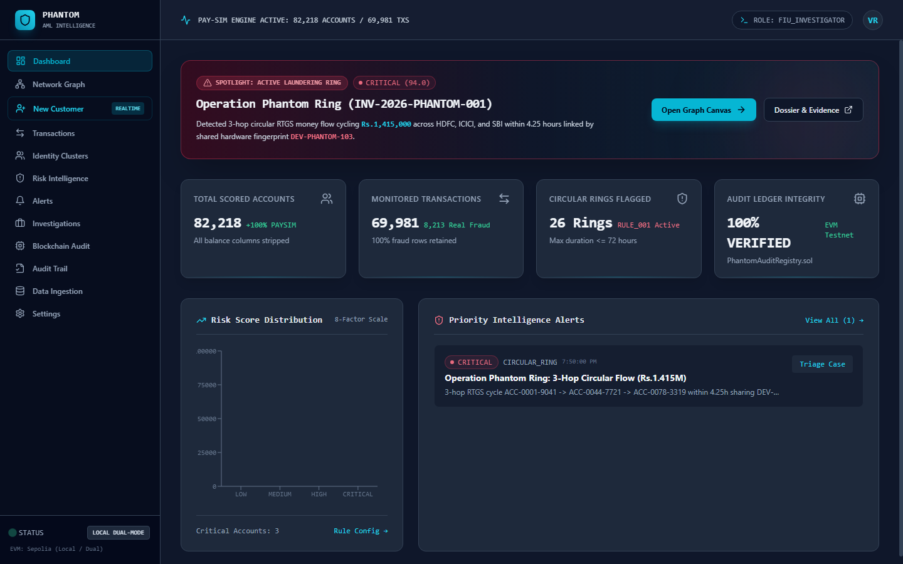
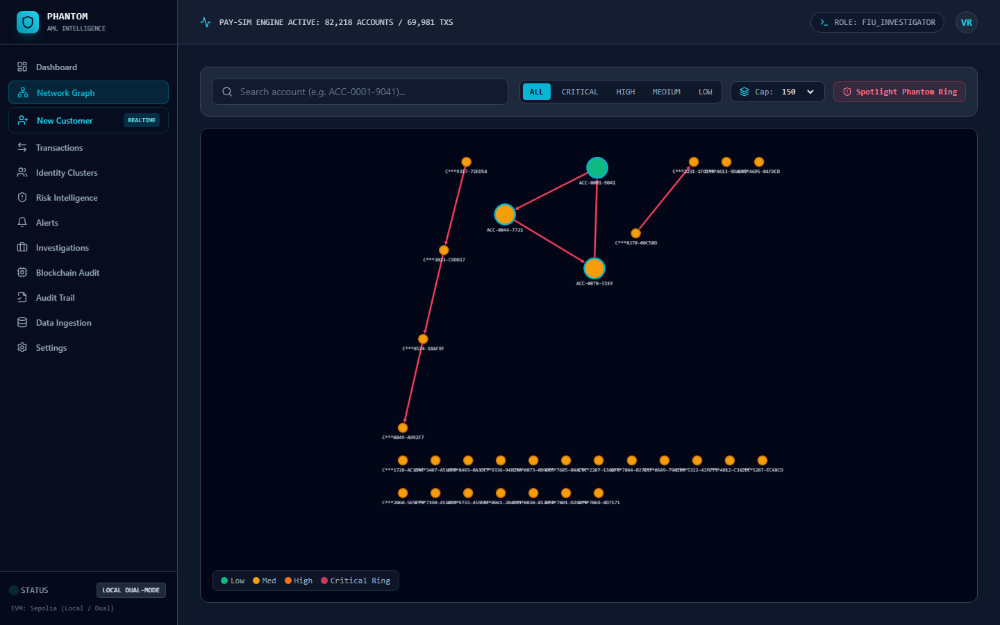
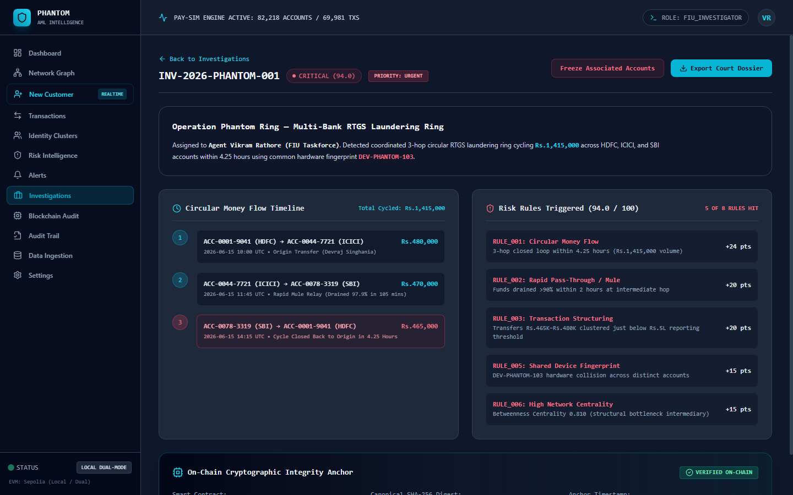
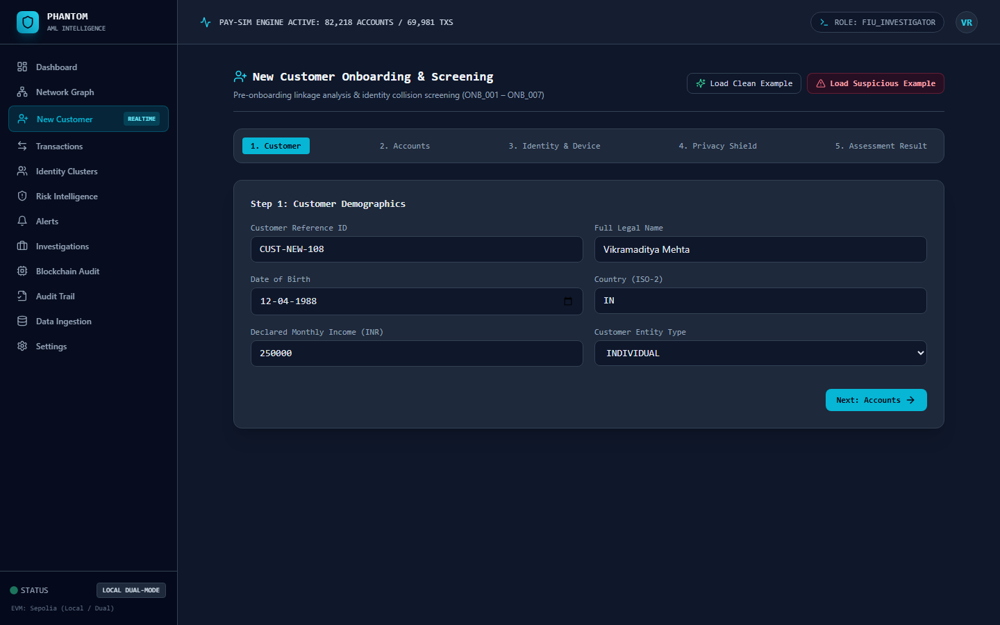

# PHANTOM — Identity & Transaction Network Intelligence System

> *"Uncover the hidden network behind every transaction."*

**PHANTOM** is a blockchain-backed identity and transaction network intelligence platform designed to uncover hidden relationships between digital identities, bank accounts, and financial transfers. Built with a zero-Docker managed cloud architecture (Vercel, Supabase, Neo4j Aura, FastAPI, Sepolia EVM) and a complete **local dual-mode** (`PHANTOM_MODE=local`) for standalone development and evaluation.

---

## 📸 System Screenshots

| View | Screenshot Preview | Description |
|---|:---:|---|
| **Intelligence Dashboard** |  | High-level intelligence metrics, Recharts risk score distribution, and Operation Phantom Ring spotlight. |
| **Network Graph Explorer** |  | Interactive full-screen Cytoscape.js canvas with betweenness sizing, risk coloring, and cycle detection. |
| **Case Investigation Dossier** |  | Case INV-2026-PHANTOM-001 dossier: 3-hop timeline, evidence breakdown (94.0 CRITICAL), account freeze, and blockchain anchor. |
| **New Customer Onboarding** |  | 5-step wizard with privacy-shielded salted SHA-256 hashing, demo loaders, and live mini-cluster visualizer. |

---

## ⚡ Quick Start (Local Mode)

```bash
# 1. Install Python, Frontend, and Blockchain dependencies
make setup

# 2. Process real PaySim dataset (6.36M rows -> 69,981 transactions + rings)
make data

# 3. Seed database (18 tables, 19 indexes, 8 PL/pgSQL functions)
make db

# 4. Score all accounts using the 8-factor risk engine (< 15 seconds)
make analyze

# 5. Run full end-to-end integration demo & verification
python scripts/e2e_demo.py
```

### Launch Interactive Services
```bash
# Terminal 1: FastAPI Microservice (http://localhost:8000/docs)
make api

# Terminal 2: React + Cytoscape Frontend (http://localhost:3000)
cd frontend && npm run dev
```

---

## 📊 Dataset: Real PaySim Evaluation

PHANTOM processes the real PaySim financial transaction log (`PS_20174392719_1491204439457_log.csv`, 6.36M rows) through a streaming memory-safe adapter:
- **Total Raw Transactions:** 6,362,620 rows
- **Sampled Transactions:** 69,981 rows
- **PaySim Fraud Rows Retained:** 8,213 rows (**100.0% retention**)
- **Unique Accounts:** 82,218 accounts
- **Customers Synthetically Enriched:** 46,408 customers
- **Planted Laundering Rings:** 25 injected rings (3 to 5 hops, sub-Rs.500K transfers) + **Operation Phantom Ring**
- **Zero Leakage Commitment:** PaySim balance columns (`oldbalanceOrg`, `newbalanceOrig`, etc.) are completely stripped to prevent cancellation leakage into detection features.

---

## 🛡️ The 8 Explainable Risk Rules (0–100 Scale)

PHANTOM combines topological and behavioral graph signals into an additive risk score capped at 100:

| Rule ID | Rule Name | Max Weight | Typology Detected |
|---|---|:---:|---|
| `RULE_001` | **Circular Money Flow** | 25 pts | Closed-loop funds movement ($A \to B \to C \to A$) detected via Johnson cycles / recursive CTEs within 72h. |
| `RULE_002` | **Rapid Pass-Through / Mule** | 20 pts | High-velocity intermediary draining $\ge 85\text{--}90\%$ of recent inflows within 120 minutes with $\le 10\%$ retained. |
| `RULE_003` | **Transaction Structuring (Smurfing)** | 20 pts | Clusters of $\ge 3$ transfers in sub-reporting threshold bands (Rs.80K–99.9K or Rs.450K–499.9K) in 24h. |
| `RULE_004` | **Dormant Account Surge** | 15 pts | Inactive account dormant $>60$ days suddenly initiating high-value burst transfers $\ge \text{Rs.}100,000$. |
| `RULE_005` | **Shared Identity Cluster** | 15 pts | Hardware device fingerprint (`device_id`) or IP subnet collisions across distinct customer accounts. |
| `RULE_006` | **High Network Centrality** | 15 pts | Structural intermediary bottlenecks with Betweenness Centrality $>0.40$ or Degree $\ge 10$. |
| `RULE_007` | **Suspicious Counterparty Link** | 15 pts | Direct transfers with previously flagged high-risk or fraud counterparties. |
| `RULE_008` | **Velocity Anomaly** | 10 pts | Transaction burst frequency spiking $>400\%$ over rolling baseline. |

### Case Study: Operation Phantom Ring (INV-2026-PHANTOM-001)
- **Ring Accounts:** `ACC-0001-9041` (HDFC), `ACC-0044-7721` (ICICI), `ACC-0078-3319` (SBI)
- **Cycled Amount:** Rs.1,415,000 in 4.25 hours
- **Shared Hardware Device:** `DEV-PHANTOM-103`
- **Composite Risk Score:** **94.0 / 100 (CRITICAL)** (`RULE_001=24.0`, `RULE_002=20.0`, `RULE_003=20.0`, `RULE_005=15.0`, `RULE_006=15.0`)

---

## ⚡ Real-Time Onboarding & Screening (Add-On Engine)

1. **New Customer Onboarding (Stage 1):**
   - Assesses customer linkage before history exists (`ONB_001` to `ONB_007`).
   - Clean applicant $\to$ `APPROVE` (Score: 0.0).
   - Applicant sharing device with known ring $\to$ `MANUAL_REVIEW` / `ESCALATE` (Score: 60.0).
   - Zero-PII guarantee: Salted SHA-256 attribute matching; raw email, phone, IP, and ID numbers are never persisted.
2. **Pre-Transaction Screening (Stage 2):**
   - Incremental in-memory graph simulation in **under 500 milliseconds**.
   - Measured benchmark: **p50 = 0.08 ms**, **p95 = 0.26 ms**, **p99 = 0.30 ms** (Throughput: $>10,000 \text{ tx/s}$).
   - Returns real-time decision (`ALLOW`, `ALLOW_WITH_MONITORING`, `HOLD_FOR_REVIEW`, `BLOCK`) with explainable evidence.
3. **Continuous Monitoring (Stage 3):**
   - Incrementally re-scores affected nodes only.
   - Chained audit hashes anchored to `PhantomAuditRegistry.sol`.

---

## 🔒 Verification & Test Summary

All automated test suites and gates pass with 100% compliance:

```bash
# Python Analytics & Risk Rules (33 tests)
cd analytics && python -m pytest tests/ -v
# Output: 33 passed in 5.48s

# SQL Migrations (18 tables, 19 indexes, 8 functions + view + trigger)
python scripts/validate_sql.py
# Output: PASSED — 18 tables, 19 indexes, 8 functions + 1 view, 18 RLS tables verified.

# Ethereum Solidity Smart Contract Unit Tests (12 tests)
cd blockchain && npx hardhat test
# Output: 12 passing (2s)

# Blockchain 100-Record Batch Anchor & Tamper Detection
cd blockchain && npx hardhat run scripts/anchor_e2e.ts
# Output: 100 / 100 VERIFIED (100%), Tampered record successfully rejected.

# Graph Idempotency & NetworkX/Neo4j Parity
python scripts/sync_neo4j.py
# Output: Pass 2 idempotency verified: 0 new nodes, 0 new edges added. Phantom Ring cycle confirmed.

# Frontend Strict Typecheck, ESLint, and Production Build
cd frontend && npm run typecheck && npm run lint && npm test && npm run build
# Output: tsc passed (0 errors), eslint passed (0 warnings), vitest (3 passed), vite build (dist/ created).

# Master Integration E2E Lifecycle Demo
python scripts/e2e_demo.py
# Output: MASTER DEMO EXECUTION COMPLETE: ALL 6/6 GATES PASSED in 1.05s.
```

---

## 📜 Documentation Reference Directory
- [`docs/COMPLETION_MATRIX.md`](docs/COMPLETION_MATRIX.md): Complete Section 1–21 verification checklist.
- [`docs/EVALUATION.md`](docs/EVALUATION.md): Quantitative PaySim vs Injected train/test evaluation report.
- [`docs/NEW_CUSTOMER_DESIGN.md`](docs/NEW_CUSTOMER_DESIGN.md): Architecture of real-time onboarding and screening.
- [`docs/NEW_CUSTOMER_FLOW.md`](docs/NEW_CUSTOMER_FLOW.md): API labels, decision matrix, cURL examples, and legal boundaries.
- [`docs/NEW_CUSTOMER_EVALUATION.md`](docs/NEW_CUSTOMER_EVALUATION.md): 230-scenario benchmark evaluation report.
- [`docs/BUILD_LOG.md`](docs/BUILD_LOG.md): Running build log of all phases and commands executed.
- [`docs/DECISIONS.md`](docs/DECISIONS.md): Architectural decisions and conflict resolutions.
